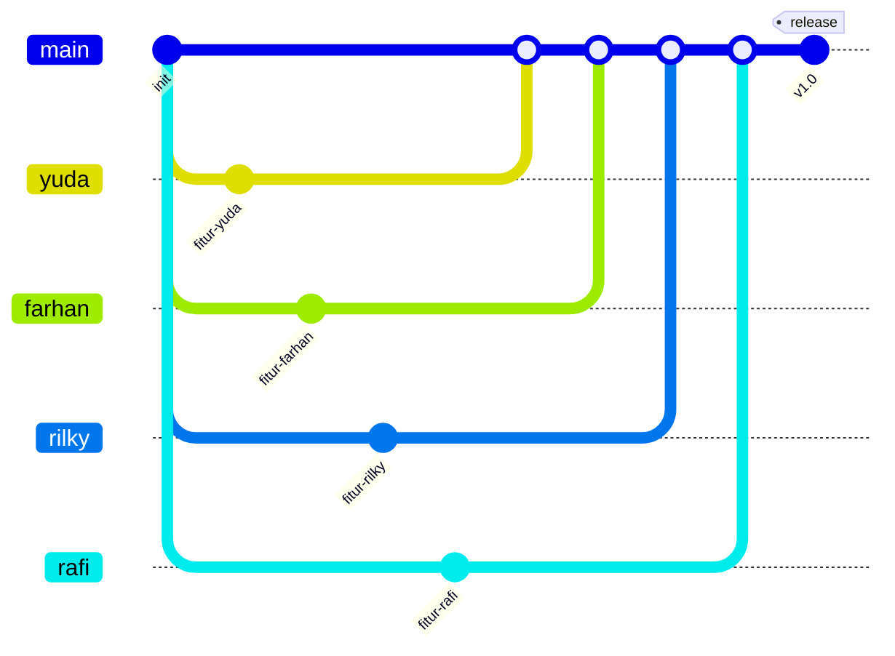

 

### 📸 *"Software yang hebat lahir dari tim yang saling percaya."*

## 👥 Crew

## 🔆 Nilai Tim

## 🎞️ Tahapan Proyek

Setiap proyek melewati enam frame siklus hidup pengembangan perangkat lunak (SDLC).

## 🌿 Alur Kerja Git

Empat anggota, empat cabang, satu rilis: semua digabung ke `main` dan dirilis sebagai versi 1.0.

## 🎒 Perlengkapan (Tech Stack)

## 📜 Misi Kami

**Tim Canonian Camera** terdiri dari empat anggota dengan satu misi: menyelesaikan tugas Rekayasa Perangkat Lunak sebelum deadline tiba.

Kami mempelajari cara merancang, membangun, dan mengelola perangkat lunak secara terstruktur. Modal kami sederhana: kerja sama tim, koneksi internet, dan kalimat sakral “tenang, masih ada waktu.”

  

## 🏆 Proyek Kami

| Proyek | Deskripsi | Dokumen |
|:---|:---|:---:|
| Canonian Camera | Aplikasi web toko kamera digital berbasis digital twin | [Proposal](./docs/Proposal_Proyek_Canonian_Camera.md) |
| Function Point & Backlog | Estimasi ukuran aplikasi dan daftar user story | [Buka](./docs/Function_Point_Canonian_Camera.md) |
| Arsitektur Sistem | Diagram arsitektur, alur komunikasi, dan ERD | [Buka](./docs/Arsitektur_Sistem_Canonian_Camera.md) |

 

