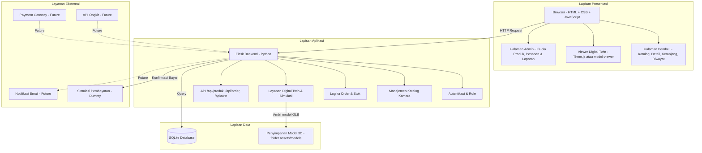
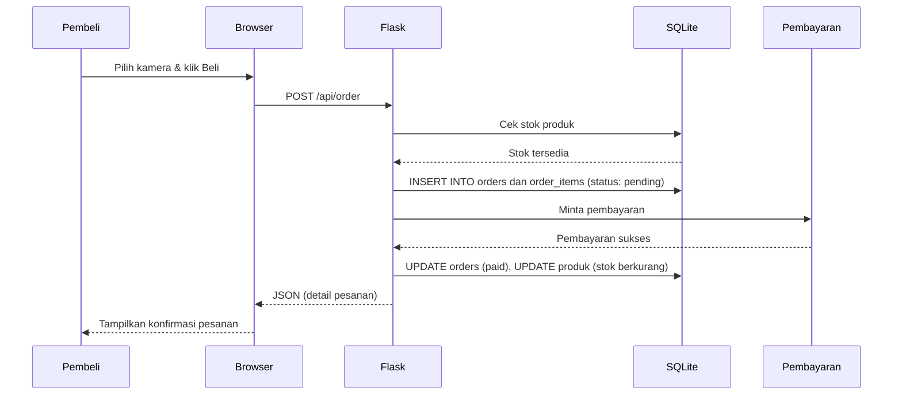
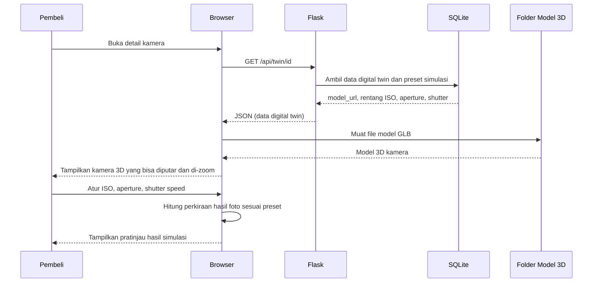
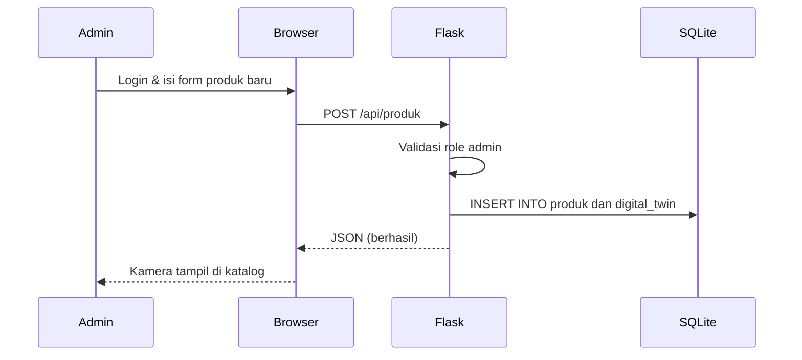
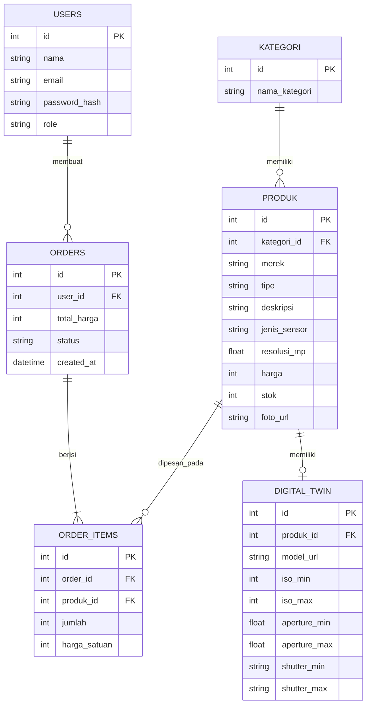

# ARSITEKTUR SISTEM — Canonian Camera

Aplikasi web toko kamera digital berbasis digital twin.

## 1. Diagram Arsitektur

## 2. Penjelasan Layer

| Layer | Komponen | Fungsi |
|-------|----------|--------|
| **Presentasi** | HTML, CSS, JavaScript, Three.js/model-viewer | Menampilkan katalog kamera, viewer digital twin 3D, keranjang, dan dashboard admin |
| **Aplikasi** | Flask (Python) | Memproses request, autentikasi, logika order dan stok, serta data simulasi digital twin |
| **Data** | SQLite + folder model 3D | Menyimpan data user, produk, pesanan, transaksi, dan preset digital twin; file model 3D (GLB) disimpan di folder aset |
| **Layanan Eksternal** | Simulasi Pembayaran / Payment Gateway / API Ongkir | Memproses pembayaran dan menghitung ongkos kirim |

## 3. Alur Komunikasi

### 3.1 Alur Pembelian Kamera

### 3.2 Alur Digital Twin dan Simulasi Kamera

### 3.3 Alur Admin Menambah Produk

## 4. Rancangan Tabel Database

## 5. Teknologi yang Digunakan

| Komponen | Teknologi | Alasan |
|----------|-----------|--------|
| Backend | Flask | Ringan, mudah dipelajari |
| Database | SQLite | Tidak perlu server, portable |
| Frontend | HTML + CSS + JavaScript | Sederhana, tanpa framework berat |
| Digital Twin 3D | Three.js atau model-viewer (format GLB) | Menampilkan model 3D langsung di browser tanpa plugin |
| Keamanan | Werkzeug (hash password) | Password tidak disimpan sebagai teks biasa |
| Pembayaran | Simulasi (dummy) | Bisa didemokan tanpa akun merchant |
| Version Control | Git + GitHub | Standar industri |
| Diagram | Mermaid | Render langsung di GitHub |

## 6. Kelebihan Arsitektur Ini

- **Modular** - Setiap layer terpisah, mudah dikembangkan
- **Interaktif** - Digital twin membuat pembeli bisa melihat dan mencoba kamera secara virtual sebelum membeli
- **Tanpa Layanan Berbayar** - Bisa jalan dengan simulasi pembayaran
- **Future-proof** - Siap diintegrasikan dengan payment gateway (mis. Midtrans), API ongkir (mis. RajaOngkir), dan email notifikasi
- **Aman** - Ada pemisahan role (pembeli/admin) dan password ter-hash
- **Ringan** - Tidak butuh server besar
