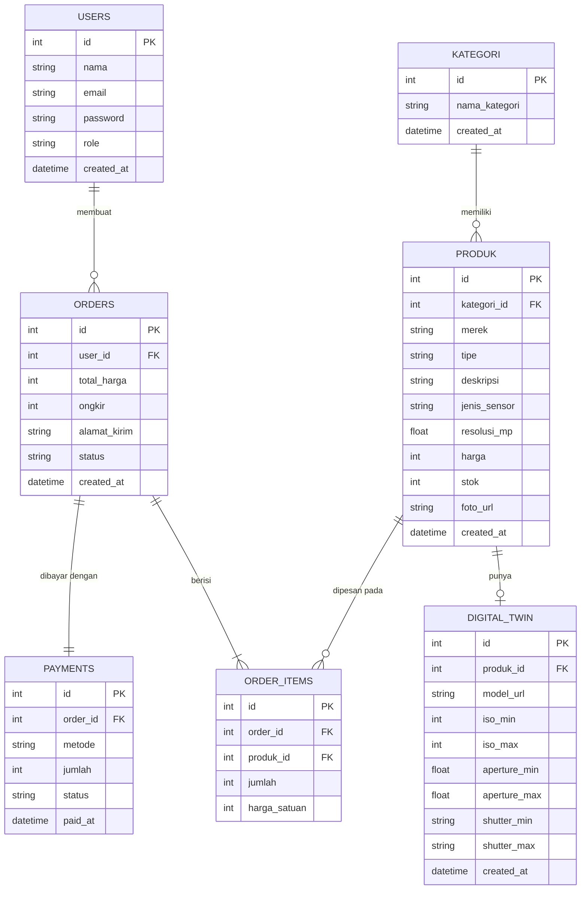

# ENTITY RELATIONSHIP DIAGRAM (ERD)
## Canonian Camera: Toko Kamera Digital Berbasis Digital Twin

## 1. Diagram ERD

## 2. Detail Tabel

### Tabel: `users`
| Field | Tipe | Keterangan |
|-------|------|-----------|
| id | INTEGER | Primary Key, Auto Increment |
| nama | VARCHAR(100) | Not Null |
| email | VARCHAR(100) | Unique, Not Null |
| password | VARCHAR(255) | Hash, Not Null |
| role | VARCHAR(10) | `pembeli` atau `admin`, Default `pembeli` |
| created_at | DATETIME | Default CURRENT_TIMESTAMP |

### Tabel: `kategori`
| Field | Tipe | Keterangan |
|-------|------|-----------|
| id | INTEGER | Primary Key |
| nama_kategori | VARCHAR(50) | Unique, Not Null (mis. Mirrorless, DSLR, Pocket) |
| created_at | DATETIME | Default CURRENT_TIMESTAMP |

### Tabel: `produk`
| Field | Tipe | Keterangan |
|-------|------|-----------|
| id | INTEGER | Primary Key |
| kategori_id | INTEGER | Foreign Key ke kategori.id |
| merek | VARCHAR(50) | Not Null |
| tipe | VARCHAR(100) | Not Null (nama/seri kamera) |
| deskripsi | TEXT | Detail spesifikasi dan keunggulan kamera |
| jenis_sensor | VARCHAR(30) | Mis. Full Frame, APS-C, 1 inci |
| resolusi_mp | DECIMAL(4,1) | Resolusi dalam megapiksel |
| harga | INTEGER | Harga dalam Rupiah, Not Null |
| stok | INTEGER | Jumlah stok, Default 0 |
| foto_url | VARCHAR(255) | Lokasi foto produk |
| created_at | DATETIME | Default CURRENT_TIMESTAMP |

### Tabel: `digital_twin`
| Field | Tipe | Keterangan |
|-------|------|-----------|
| id | INTEGER | Primary Key |
| produk_id | INTEGER | Foreign Key ke produk.id, Unique |
| model_url | VARCHAR(255) | Lokasi file model 3D (format GLB) |
| iso_min | INTEGER | Batas bawah ISO untuk simulasi |
| iso_max | INTEGER | Batas atas ISO untuk simulasi |
| aperture_min | DECIMAL(3,1) | Bukaan diafragma terbesar (mis. f/1.8) |
| aperture_max | DECIMAL(3,1) | Bukaan diafragma terkecil (mis. f/22) |
| shutter_min | VARCHAR(10) | Kecepatan rana paling lambat (mis. 30s) |
| shutter_max | VARCHAR(10) | Kecepatan rana paling cepat (mis. 1/4000) |
| created_at | DATETIME | Default CURRENT_TIMESTAMP |

### Tabel: `orders`
| Field | Tipe | Keterangan |
|-------|------|-----------|
| id | INTEGER | Primary Key |
| user_id | INTEGER | Foreign Key ke users.id |
| total_harga | INTEGER | Total harga barang saat pembelian (Rupiah) |
| ongkir | INTEGER | Ongkos kirim (Rupiah), Default 0 |
| alamat_kirim | TEXT | Alamat pengiriman, Not Null |
| status | VARCHAR(10) | `pending`, `paid`, `dikirim`, `selesai`, atau `batal`, Default `pending` |
| created_at | DATETIME | Default CURRENT_TIMESTAMP |

### Tabel: `order_items`
| Field | Tipe | Keterangan |
|-------|------|-----------|
| id | INTEGER | Primary Key |
| order_id | INTEGER | Foreign Key ke orders.id |
| produk_id | INTEGER | Foreign Key ke produk.id |
| jumlah | INTEGER | Jumlah unit yang dibeli, Not Null |
| harga_satuan | INTEGER | Harga per unit saat pembelian (Rupiah) |

### Tabel: `payments`
| Field | Tipe | Keterangan |
|-------|------|-----------|
| id | INTEGER | Primary Key |
| order_id | INTEGER | Foreign Key ke orders.id, Unique |
| metode | VARCHAR(30) | Mis. Transfer Bank, E-Wallet (simulasi) |
| jumlah | INTEGER | Nominal pembayaran (Rupiah) |
| status | VARCHAR(10) | `menunggu`, `sukses`, atau `gagal` |
| paid_at | DATETIME | Waktu pembayaran berhasil, boleh kosong |

## 3. Relasi Antar Tabel

| Relasi | Tipe | Keterangan |
|--------|------|-----------|
| users -> orders | One to Many | 1 pembeli bisa membuat banyak pesanan |
| kategori -> produk | One to Many | 1 kategori punya banyak kamera |
| produk -> digital_twin | One to One (opsional) | 1 kamera punya 1 data digital twin (model 3D dan preset simulasi) |
| orders -> order_items | One to Many | 1 pesanan berisi satu atau lebih item kamera |
| produk -> order_items | One to Many | 1 kamera bisa muncul di banyak pesanan |
| orders -> payments | One to One | 1 pesanan punya 1 data pembayaran |
